<div align="center">

# 🏡 Lodge

**A full-stack vacation rental platform: browse unique stays, pick your dates, see the full price and book.**

Built with **ASP.NET Core 11** (Clean Architecture + CQRS) and **Next.js 16** (React 19).

[](https://github.com/HilthonTT/Lodge/actions/workflows/ci.yml)


[](LICENSE)

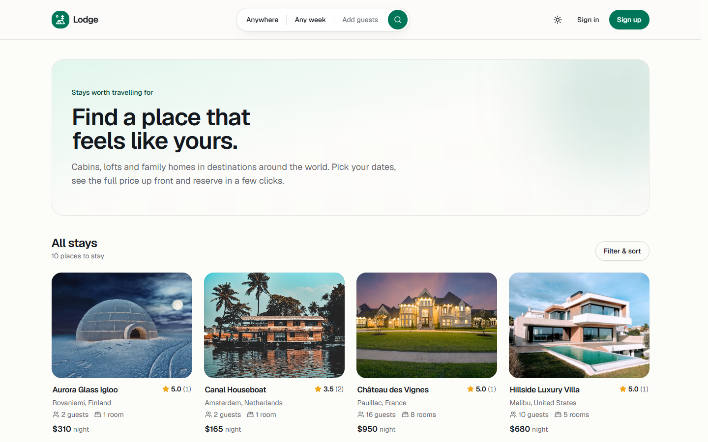

</div>

---

## Contents

- [Screenshots](#screenshots)
- [Features](#features)
- [Tech stack](#tech-stack)
- [Quick start](#quick-start)
- [Project structure](#project-structure)
- [Documentation](#documentation)
- [Contributing](#contributing)
- [License](#license)

## Screenshots

### Booking a stay

Pick dates on the availability calendar. Booked nights are crossed out, and the price breakdown updates live.

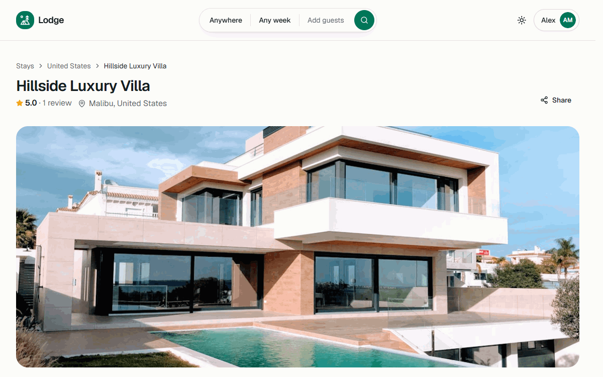

### Searching


### Dark mode

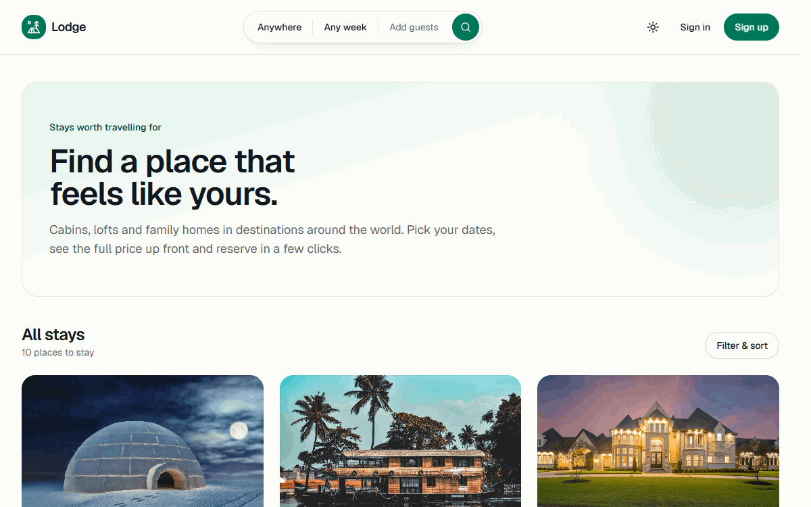

<details>
<summary><b>More screenshots</b></summary>

| | |
| --- | --- |
| **Apartment detail** <br/> 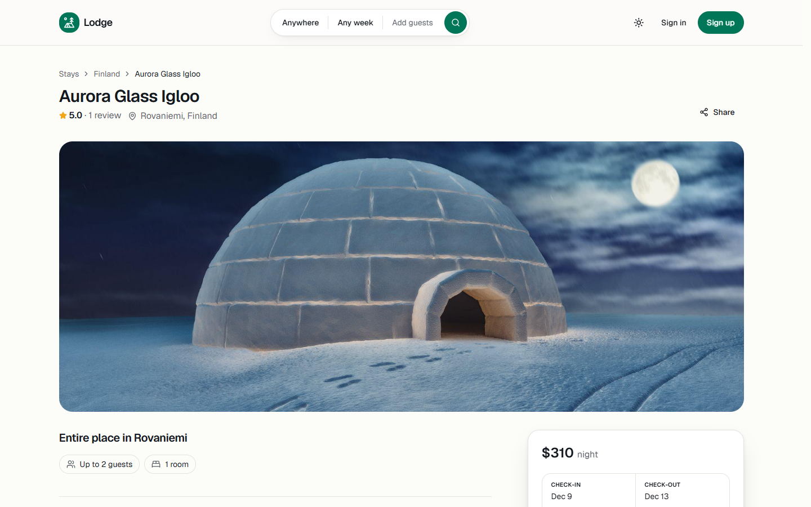 | **Booking panel and price breakdown** <br/> 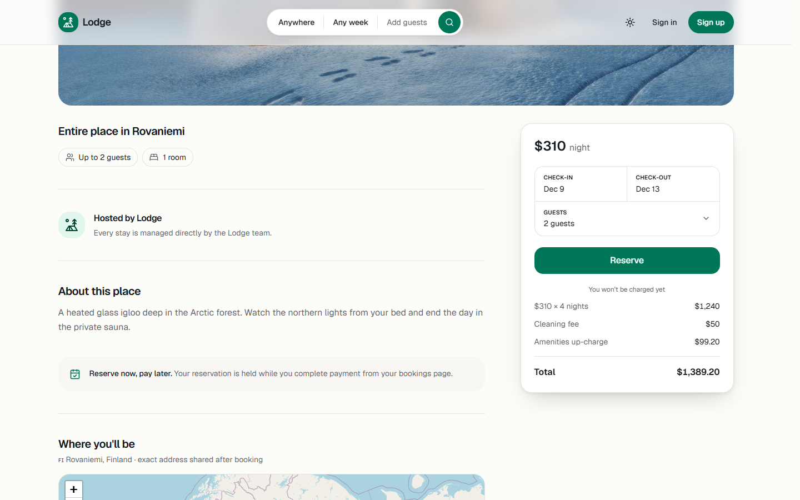 |
| **Search results** <br/> 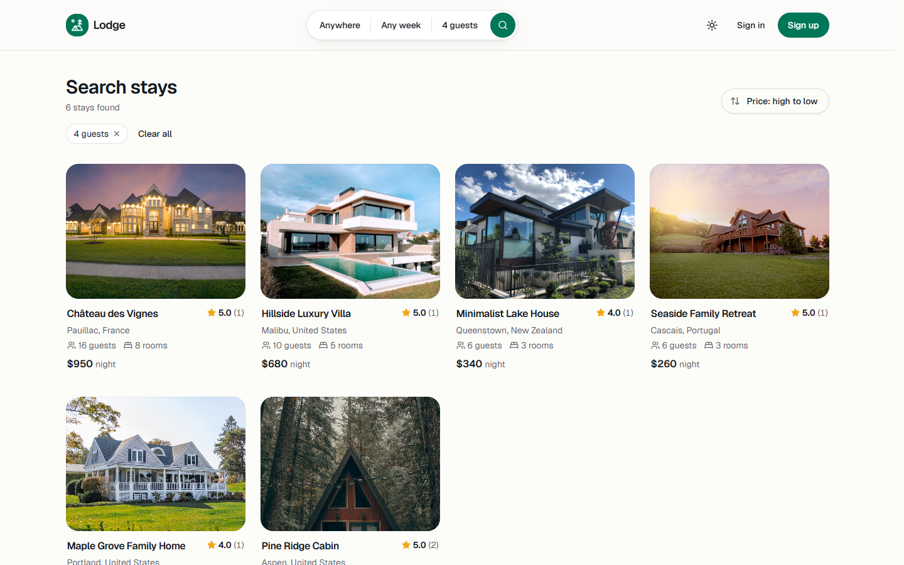 | **My bookings** <br/> 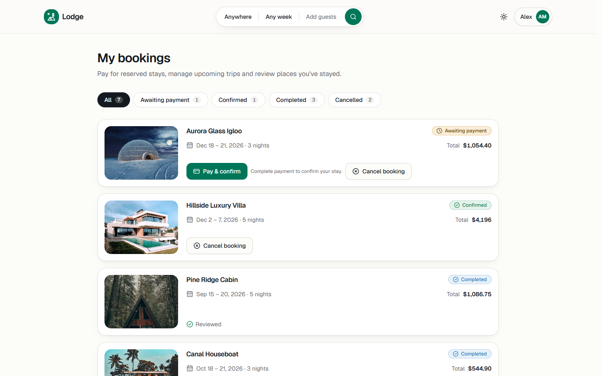 |
| **Dark theme** <br/> 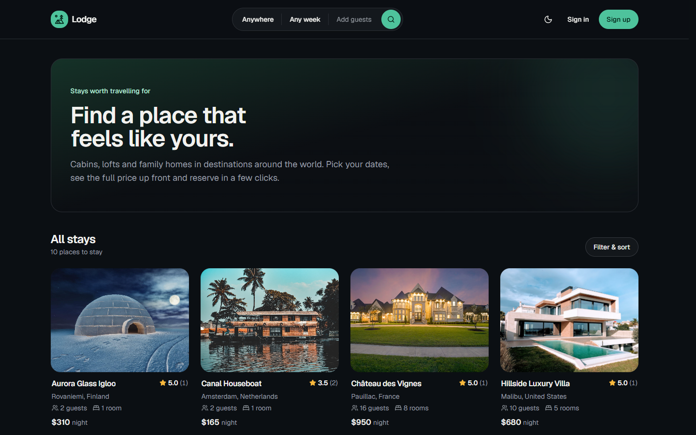 | **Dark theme: detail** <br/> 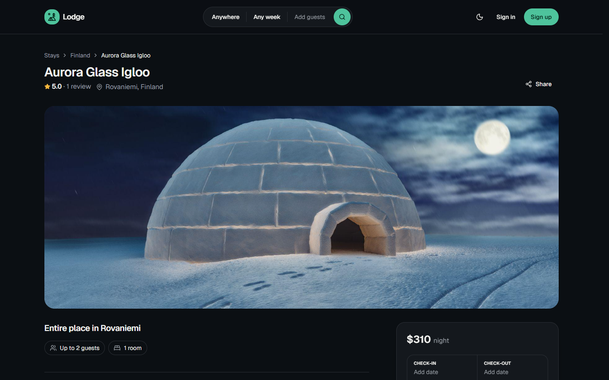 |
| **Sign in** <br/> 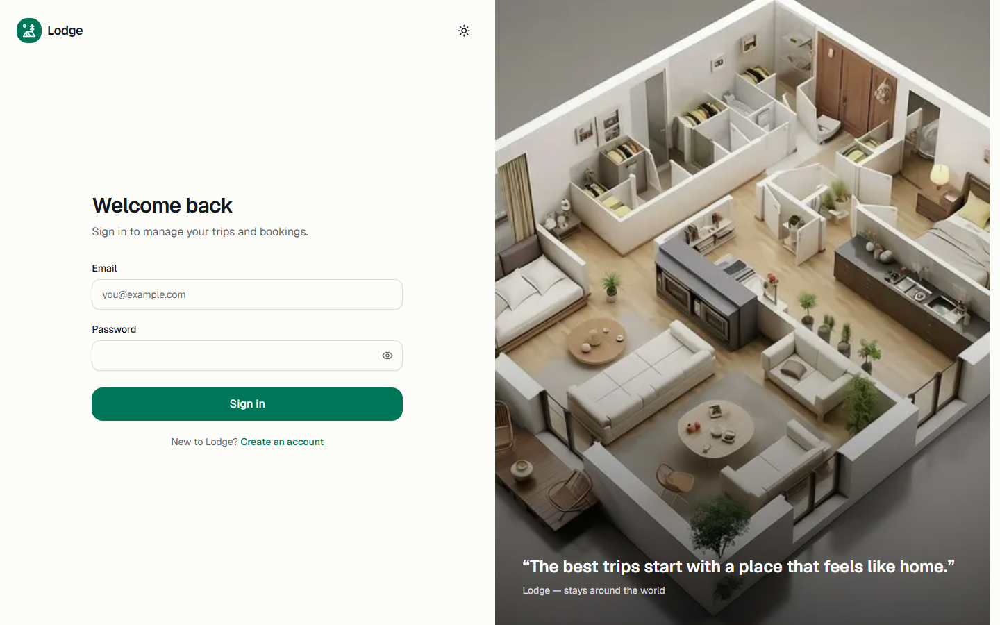 | **Account settings** <br/> 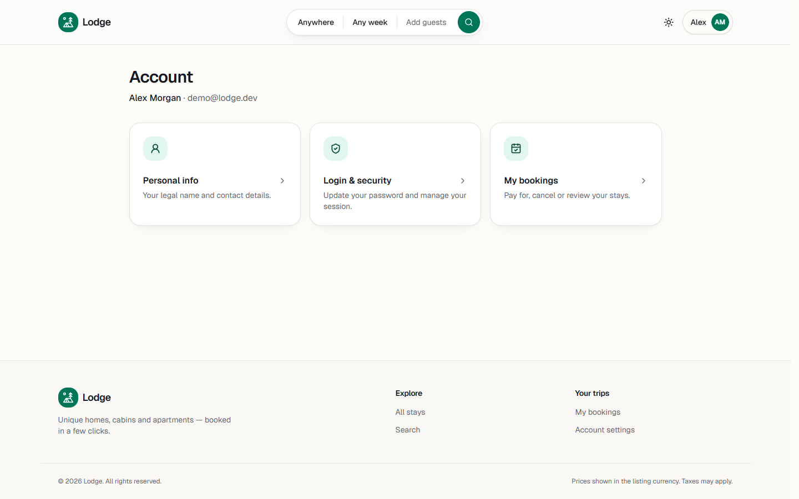 |
| **Admin: manage bookings** <br/> 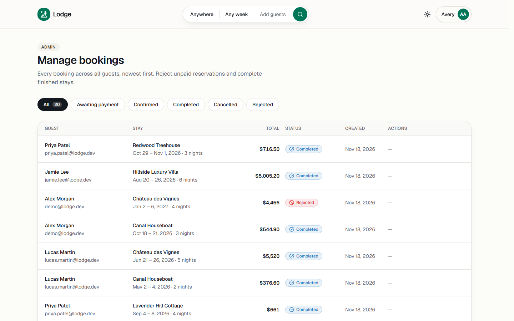 | **Not found** <br/> 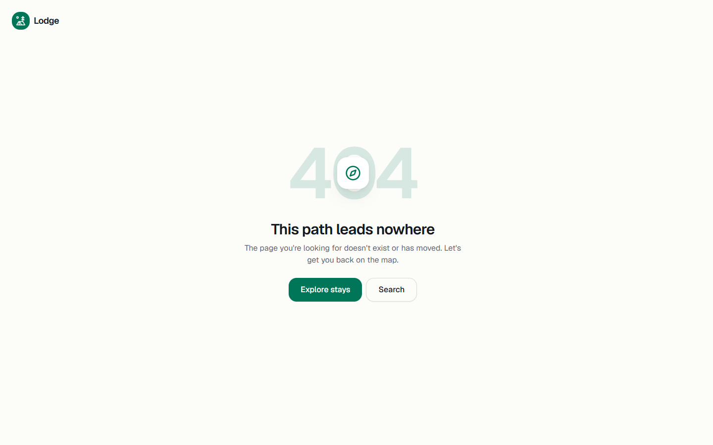 |

| Mobile: home | Mobile: apartment |
| --- | --- |
| 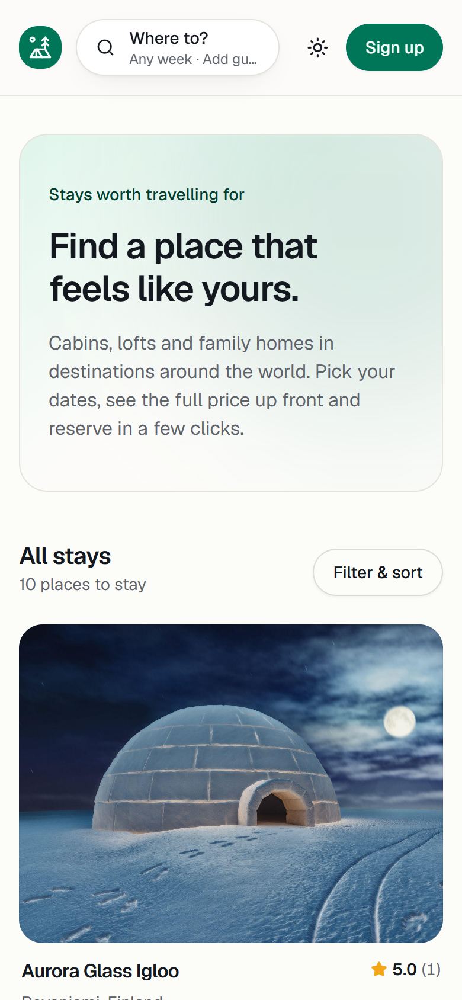 | 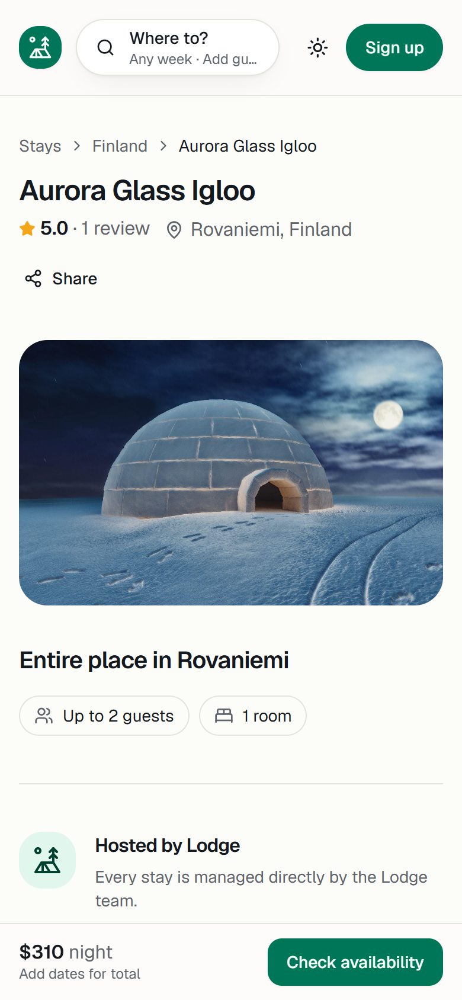 |

</details>

## Features

**For guests**

- 🔎 **Search and filter** by destination, dates, guests and rooms, sorted by price, name or rating. Only stays that are free for the chosen dates are shown.
- 📅 **Availability calendar** that supports back-to-back stays (you can check in on another guest's check-out day).
- 💵 **Transparent pricing**: nightly rate, amenity up-charge, cleaning fee and total, all calculated by the backend.
- 💳 **Stripe Checkout** to pay for a reservation. A signed webhook confirms the booking.
- ⭐ **Ratings and reviews** on every listing, written by guests after a completed stay.
- 🧾 **My bookings** with status filters, cancellation, and reviews for completed stays.
- 👤 **Account settings**: personal info and password.
- 🌗 **Light, dark and system themes**, responsive down to mobile, keyboard-accessible.

**For admins**

- 🛡️ **Manage bookings**: every booking across all guests, filterable by status, with reject and mark-completed actions.
- ⏰ Finished stays are also completed automatically by a daily background job.

**Under the hood**

- 🧱 **Clean Architecture**: Domain, Application, Infrastructure, Persistence and Presentation layers. The layering rules are enforced by architecture tests.
- 📨 **CQRS with MediatR**, plus pipeline behaviors for validation, caching, unit of work, idempotency and logging.
- 📦 **Transactional outbox → RabbitMQ**: domain events become integration events (e.g. booking e-mails) without losing messages.
- ⚡ **Redis query cache** and **Dapper** for read-heavy queries, **EF Core** for writes.
- 🔐 **JWT authentication** with roles (guest / admin), per-resource ownership checks and PBKDF2-SHA512 password hashing.
- 🔁 **Idempotent commands** via an `X-Idempotency-Key` header, so double-submits are safe.
- 🌐 **YARP gateway** with per-IP rate limiting in front of the API.
- 🩺 **Health checks**, **Serilog → Seq** structured logging, **Hangfire** dashboard, **Scalar** API docs.
- ✅ **171 tests**: unit, architecture, plus integration and functional tests against real PostgreSQL and Redis using Testcontainers.

## Tech stack

| Area | Technologies |
| --- | --- |
| **Backend** | .NET 11, ASP.NET Core minimal APIs, EF Core 10 + Npgsql, Dapper, MediatR, FluentValidation, Asp.Versioning, Scalar/OpenAPI |
| **Messaging & jobs** | RabbitMQ 4, Hangfire (transactional outbox) |
| **Data** | PostgreSQL 18, Redis 8, Azure Blob Storage (Azurite locally) |
| **Gateway** | YARP reverse proxy, ASP.NET Core rate limiting |
| **Frontend** | Next.js 16 (App Router), React 19, TypeScript, Tailwind CSS 4, Radix UI / shadcn, TanStack Query, react-hook-form + zod, next-themes, Leaflet |
| **Observability** | Serilog, Seq, health checks |
| **Payments & e-mail** | Stripe Checkout, MailKit (Mailpit locally) |
| **Testing** | xunit v3, AwesomeAssertions, NSubstitute, Testcontainers, NetArchTest, Bogus |
| **Tooling** | Docker Compose, GitHub Actions, Dependabot, Central Package Management, `.slnx` solution |

## Quick start

**Prerequisites:** [Docker](https://www.docker.com/). Add the [.NET 11 SDK](https://dotnet.microsoft.com/download) and [Node.js 22.12+](https://nodejs.org/) if you want to run the code outside Docker.

```bash
git clone https://github.com/HilthonTT/Lodge.git
cd Lodge
docker compose up -d --build
```

Then open **<http://localhost:3000>** and sign in with one of these:

| E-mail | Password | Role |
| --- | --- | --- |
| `demo@lodge.dev` | `Demo123!` | Guest, with bookings in every status |
| `admin@lodge.dev` | `Admin123!` | Admin, can open **Manage bookings** |

The database is migrated and seeded with demo apartments, bookings and reviews on first start.

| What | Where |
| --- | --- |
| Web app | <http://localhost:3000> |
| API gateway | <http://localhost:8000> |
| API docs (Scalar) | <http://localhost:5000/scalar> |
| Logs (Seq) | <http://localhost:8081> |
| Captured e-mails (Mailpit) | <http://localhost:8025> |
| Background jobs (Hangfire) | <http://localhost:5000/hangfire> |
| RabbitMQ management | <http://localhost:15672> (guest / guest) |

Payments are optional. Without Stripe keys everything else works; see [Stripe setup](docs/development.md#stripe-optional).

Running the API or frontend from source with hot reload, configuration, migrations and tests are all covered in the **[development guide](docs/development.md)**.

## Project structure

```
Lodge/
├─ Lodge.slnx                     # .NET solution (XML format)
├─ global.json                    # pinned .NET SDK
├─ Directory.Build.props          # shared MSBuild settings (net11.0, nullable, warnings as errors…)
├─ Directory.Packages.props       # central NuGet versions
├─ docker-compose.yml             # full local stack
├─ backend/
│  ├─ src/
│  │  ├─ Lodge.Domain/            # entities, value objects, domain events, pricing
│  │  ├─ Lodge.Contracts/         # request/response DTOs
│  │  ├─ Lodge.Application/       # commands/queries, handlers, validators, pipeline behaviors
│  │  ├─ Lodge.Infrastructure/    # JWT, Redis, RabbitMQ, e-mail, blob storage, Hangfire
│  │  ├─ Lodge.Persistence/       # EF Core DbContext, migrations, repositories, outbox
│  │  ├─ Lodge.BackgroundTasks/   # integration-event consumers
│  │  ├─ Lodge.Presentation/      # minimal API endpoints, problem details, OpenAPI
│  │  ├─ Lodge.Api/               # composition root, seeding, Dockerfile
│  │  └─ Lodge.Gateway/           # YARP reverse proxy, Dockerfile
│  └─ tests/
│     ├─ Lodge.Domain.UnitTests/
│     ├─ Lodge.Application.UnitTests/
│     ├─ Lodge.Application.IntegrationTests/
│     ├─ Lodge.Api.FunctionalTests/
│     └─ Lodge.ArchitectureTests/
├─ frontend/                      # Next.js 16 app (see frontend/README.md)
│  └─ src/{app,features,components,lib,types}
├─ docs/                          # architecture, API, development, CI/CD, screenshots
├─ scripts/screenshots/           # Playwright script that regenerates docs/images
└─ .github/                       # CI/CD workflow and Dependabot
```

## Documentation

| Guide | What's inside |
| --- | --- |
| [Architecture](docs/architecture.md) | System diagram, layers, request pipeline, outbox flow, booking state machine |
| [API reference](docs/api.md) | Endpoints, authentication, paging, errors, idempotency |
| [Development guide](docs/development.md) | Running from source, configuration, Stripe, migrations, tests, troubleshooting |
| [Frontend](docs/frontend.md) | Folder layout, data flow, auth, design tokens, adding a feature |
| [CI/CD](docs/ci-cd.md) | GitHub Actions pipeline, container images, Dependabot |

## Contributing

1. Fork the repository and create a feature branch.
2. Make sure the checks pass locally:
   ```bash
   dotnet build Lodge.slnx -warnaserror && dotnet test Lodge.slnx
   cd frontend && npm run check
   ```
3. Open a pull request. CI runs the same checks and builds the Docker images.

## License

[MIT](LICENSE) © 2024 Timothy
