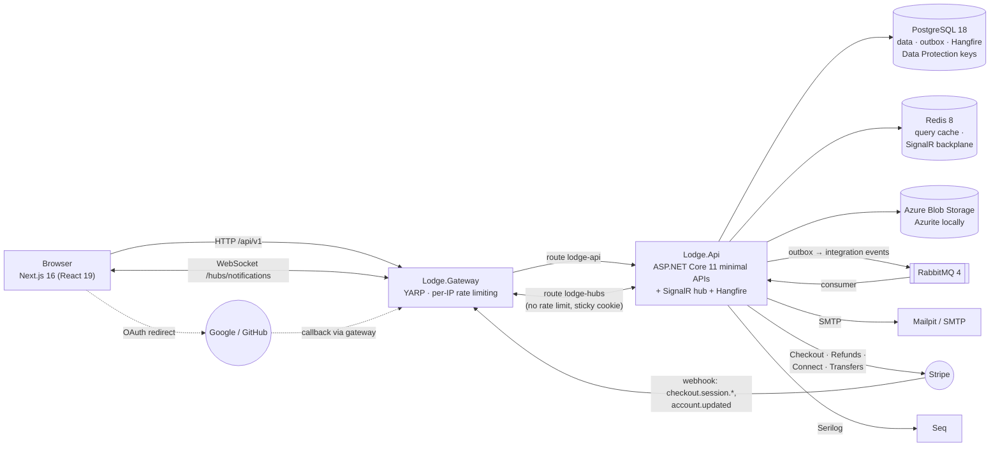
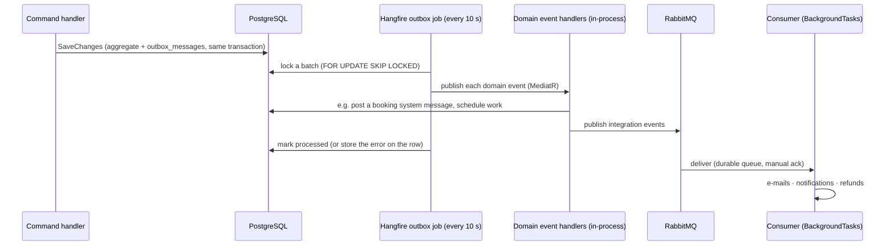
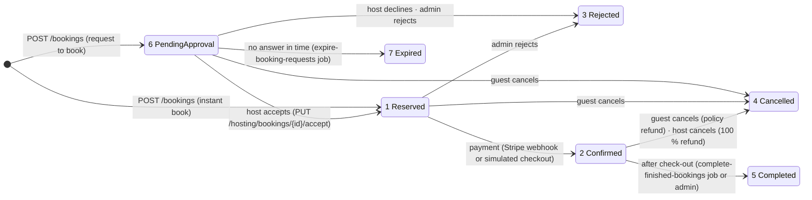
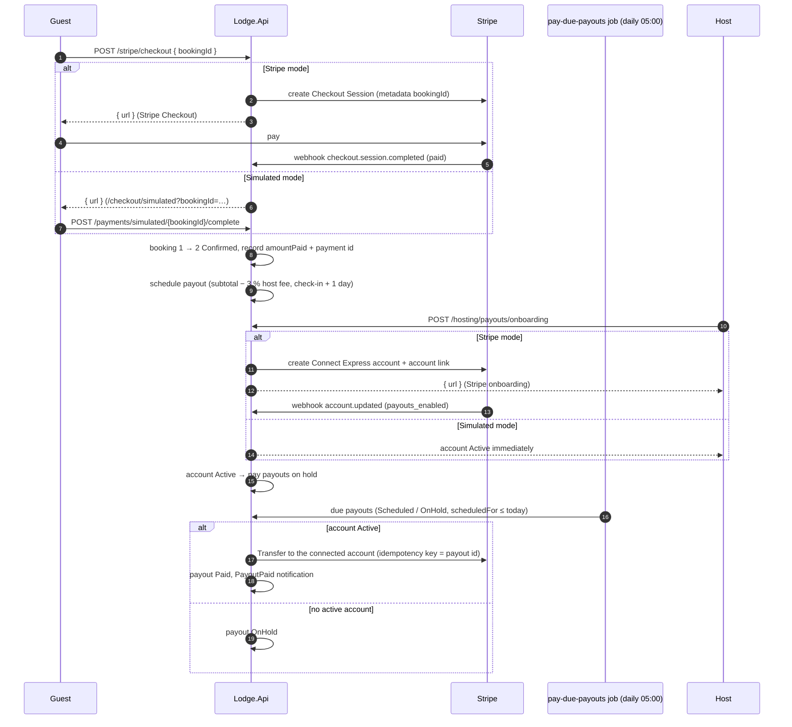
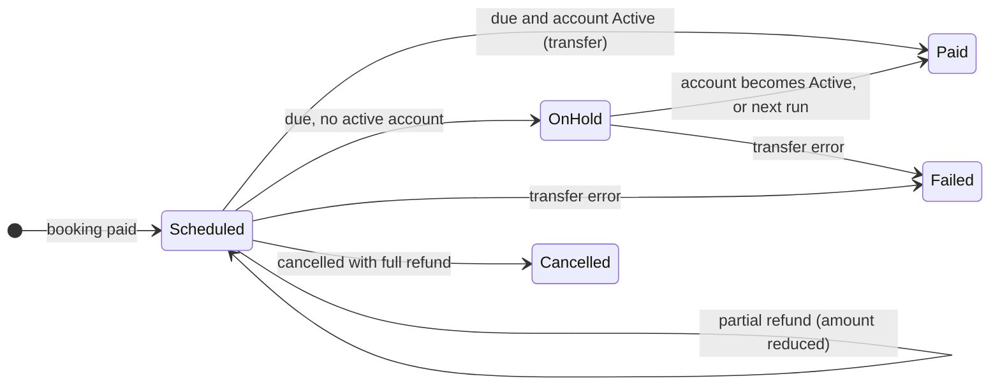
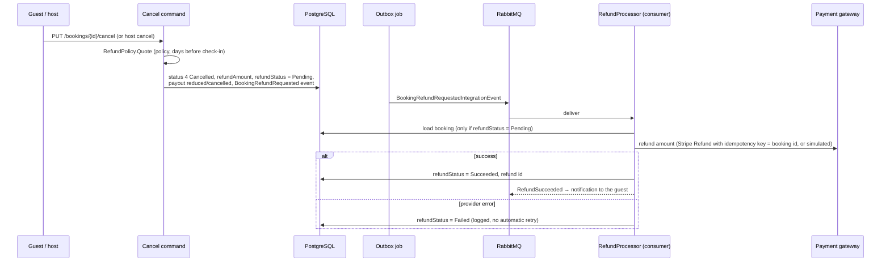
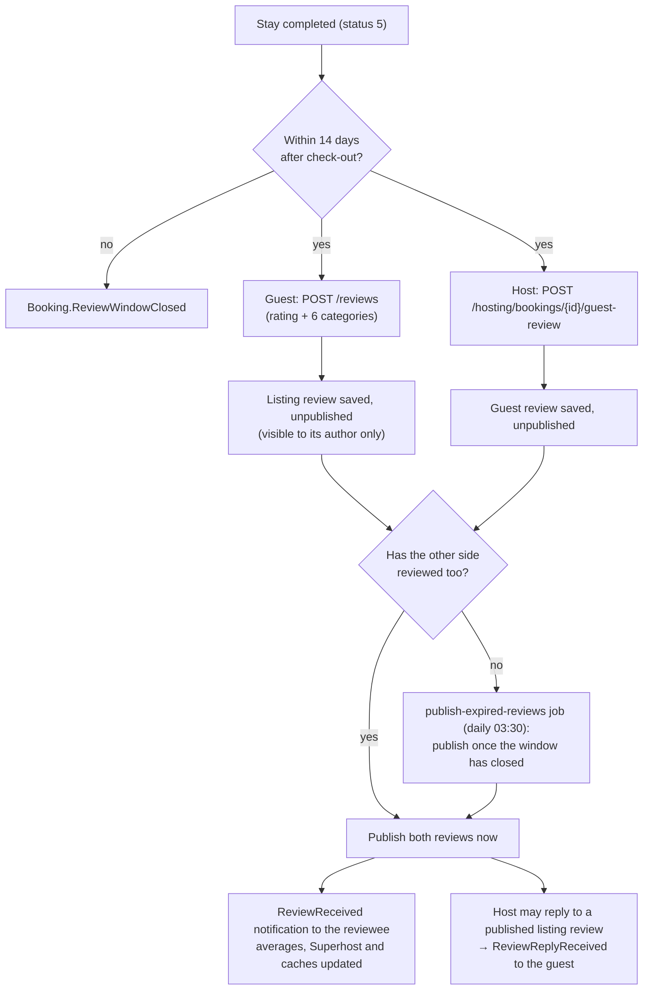
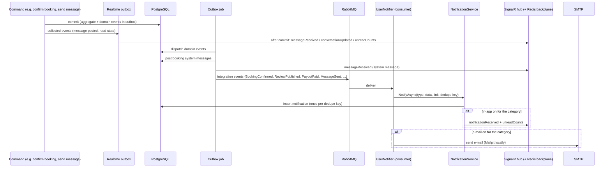
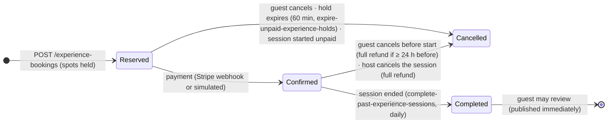

# Architecture

Lodge is split into a **Next.js frontend** and an **ASP.NET Core backend** that follows Clean Architecture with CQRS. All browser traffic, including the SignalR WebSocket, goes through a YARP gateway.

* The gateway has two routes:
  * `lodge-hubs` matches `/hubs/**`. WebSockets are proxied as-is, the route is exempt from rate limiting, and the `.Lodge.Hubs.Affinity` cookie keeps negotiate and connect requests on the same API instance.
  * `lodge-api` matches everything else and applies the per-IP fixed-window limit.
* CORS is handled only by the API; the gateway forwards preflight requests unchanged.
* SignalR uses Redis as a backplane, so events published by one API instance reach connections on any other.
* In **Simulated** payment mode, Stripe isn't called at all (see [Payments](#payment-and-payout-lifecycle)).

## Backend layers

| Project | Responsibility | May reference |
| --- | --- | --- |
| `Lodge.Domain` | Entities and aggregates (users, apartments, bookings, reviews, payouts, wishlists, conversations, notifications, experiences), value objects (`Email`, `Money`, `DateRange`, …), domain events and domain services. Examples are `PricingService`, `RefundPolicy`, `FlexibleStay` and the Superhost rules. Also repository interfaces and the `Result`/`Error` primitives. No framework dependencies. | — |
| `Lodge.Contracts` | Request/response DTOs and e-mail models shared over the wire. | — |
| `Lodge.Application` | Use cases as MediatR commands/queries and handlers, FluentValidation validators and pipeline behaviors. Also payments (`BookingPayments`, the gateways, `RefundProcessor`), notifications (`UserNotifier`, `NotificationService`), the realtime outbox, the recurring job implementations and the abstractions for infrastructure. | Domain, Contracts |
| `Lodge.Infrastructure` | JWTs, password hashing, TOTP, Google/GitHub OAuth, Data Protection secret encryption, the Redis cache, MailKit e-mail, the RabbitMQ publisher, blob storage, Hangfire, health checks and the time provider. | Application |
| `Lodge.Persistence` | EF Core `LodgeDbContext` (snake_case naming), configurations, migrations, repositories and the Dapper connection factory. Also the interceptors (auditing, soft delete, outbox), the outbox processor, the idempotency store and the Data Protection key ring. | Application |
| `Lodge.BackgroundTasks` | RabbitMQ consumer hosted service and integration-event handlers: e-mails, notifications and refunds. | Infrastructure |
| `Lodge.Presentation` | Minimal API endpoints (`IEndpoint`), result → HTTP mapping, problem details, OpenAPI configuration, the SignalR `NotificationsHub` and `SignalRRealtimeNotifier`. | Application |
| `Lodge.Api` | Composition root: `Program.cs`, the middleware pipeline, Hangfire job registration, and migrations + demo seeding in Development. | everything |
| `Lodge.Gateway` | YARP reverse proxy in front of the API, with per-IP fixed-window rate limiting and a separate route for the SignalR hubs. | — |

The layering rules are enforced by `Lodge.ArchitectureTests` (NetArchTest).

## Request pipeline

Every command or query goes through these MediatR behaviors, from the outermost to the innermost:

1. **RequestLogging** logs the request name and, on failure, the error. It uses Serilog with a correlation id from `RequestContextLoggingMiddleware` (also returned in the `X-Correlation-Id` header).
2. **Validation** runs the FluentValidation validators and short-circuits with a `ValidationError` result (`Validation.General`).
3. **QueryCaching** caches the results of `ICachedQuery` queries in Redis. User-specific queries are never cached.
4. **CacheInvalidation** removes the cache keys that a command registered through `ICacheInvalidator`. It runs only after the command succeeded and committed.
5. **UnitOfWork** wraps every command in a database transaction. On failure (or an exception) everything is rolled back, including the idempotency record. On success it saves, commits and then flushes the **realtime outbox**: the SignalR events the command collected are pushed only once the data they describe is committed.
6. **IdempotentCommand** applies to commands with an `X-Idempotency-Key`. A transaction-scoped advisory lock on the key makes a concurrent duplicate fail with `409 Request.InProgress`. A key already used by the same command replays the stored result instead of running the command again, and a key used by another command fails with `409 Request.KeyReused`. On success, the key and the serialized result are stored in the same transaction.

Handlers return `Result`/`Result<T>` instead of throwing. `Lodge.Presentation` maps error types to HTTP status codes:

| Error type | HTTP status |
| --- | --- |
| Validation | 400 |
| Problem | 400 |
| NotFound | 404 |
| Conflict | 409 |
| Permission | 403 |
| TooManyRequests | 429 |
| Failure (unexpected) | 500 |

Missing or invalid JWTs are rejected with 401 by the authentication middleware. Binding failures (`BadHttpRequestException`) are answered by `GlobalExceptionHandler` with 400 `Request.InvalidBody` or `Request.InvalidParameter`, because `ThrowOnBadRequest` is on in every environment.

Errors are returned as `application/problem+json`. See [api.md](api.md#errors).

## Events and the outbox

* An interceptor collects domain events and writes them to `outbox_messages` in the same transaction as the aggregate, so no event is lost.
* Hangfire processes the outbox on the schedule in `BackgroundJobs:Outbox:Schedule` (every 10 s), up to `BatchSize` (20) messages per run. Rows are locked with `SKIP LOCKED`, so several API instances can run the job concurrently.
* A failing message doesn't stop the batch; its error is stored on the row.
* The consumer deserializes only an allow-list of known integration event types. A message that fails is requeued once and then rejected. Handlers are idempotent: notifications are deduplicated per source event, and refunds and transfers use Stripe idempotency keys.

## Booking lifecycle

* **Request to book.** Listings with `instantBook = false` create **6 PendingApproval** bookings. The host has until the earlier of creation + `ExpiryHours` (24 h) and the end of the check-in day to accept or decline. After that, the `expire-booking-requests` job (every 15 min) moves the request to **7 Expired**. Accepting is not possible once the check-in date has passed.
* **Pending dates are held.** Statuses 6, 1, 2 and 5 make nights unavailable to other guests.
* **Changing dates.** The guest can change the dates of a 6 or 1 booking (`PUT /bookings/{id}/dates`). The price is recalculated, and the host gets a `BookingDatesChanged` notification. A confirmed booking has to be cancelled and rebooked instead.
* **Cancelling.** The guest can cancel 6, 1 or 2 until the check-in date. The host can cancel only 2, also until the check-in date, and the guest then gets a full refund. Host cancellations count against the Superhost cancellation rate. `acceptedOnUtc` records when a booking was accepted (instant book or host acceptance); the rate only counts bookings that were accepted or declined.
* **Admin.** Admins can reject 1 or 6 and complete 2.
* **Completion.** The `complete-finished-bookings` job completes confirmed stays once they've ended, through the same domain method, so the completion e-mail is still sent via the outbox.

`BookingStatus` values on the wire are `1` Reserved, `2` Confirmed, `3` Rejected, `4` Cancelled, `5` Completed, `6` PendingApproval and `7` Expired.

**Pricing.** `PricingService` calculates the price in these steps:

1. Nightly prices: the host's override for the date, the weekend price, or the base price.
2. The weekly or monthly discount.
3. An amenity up-charge.
4. The cleaning fee. Steps 1–4 make up the stay subtotal.
5. The guest service fee: 12 % of the subtotal.
6. The occupancy tax by country, on the discounted nights.

Every booking snapshots the price breakdown and the listing's cancellation policy.

## Payment and payout lifecycle

`Payments:Mode` selects the gateway for new operations. An existing payment, refund, connected account or transfer is always handled by the gateway that created it: simulated ids start with `sim_`.

* **Stay payout.** The stay subtotal (nights − discount + up-charge + cleaning fee) minus `Payments:HostServiceFeePercent` (3 %). The guest service fee and the taxes stay with the platform. It is scheduled for check-in + 1 day.
* **Experience payout.** The price of the spots minus the host fee, scheduled for the day after the session. A refunded cancellation cancels it; a late cancellation (no refund) keeps it.
* **Failures.** Failed transfers aren't retried automatically.

## Refund pipeline

* **Refundable amount.** The policy percentage is applied to the nights after the discount plus the up-charge. The cleaning fee is always refunded, the service fee only at 100 %, and taxes in proportion.
* **When no refund is requested.** An unpaid booking (status 6 or 1) has nothing to refund. A paid booking with a 0 % refund keeps `refundStatus = None`. A booking paid before payment tracking existed gets `Manual`.
* **Experiences.** Experience bookings follow the same pipeline (`ExperienceBookingRefundRequested`). The refund is all-or-nothing: the full amount paid when cancelled ≥ 24 h before the start or when the host cancels the session, otherwise nothing.

## Review publishing (double-blind)

* A review can be edited only while it is unpublished (`409 Review.AlreadyPublished`).
* Averages, `ratingBreakdown` and the Superhost rating count published reviews only.
* `GET /apartments/{id}/reviews` returns the published reviews plus the caller's own unpublished one.
* Experience reviews aren't double-blind: they are published immediately.

## Notifications and real-time

* **Push timing.** User messages are pushed immediately after the request commits. Booking system messages and notifications arrive through the outbox, about 10 s after the action.
* **Hub authentication.** The hub (`/hubs/notifications`) identifies users by the `userId` claim. Browsers send the token as `access_token` in the query string, which is accepted only under `/hubs`.
* **Reminders.** The daily `send-reminders` job (08:00 UTC) creates trip, arrival, review and experience reminders, using the same dedupe keys.
* **Preferences.** They are per category (`messages`, `reservations`, `reviews`, `payouts`, `reminders`) and per channel (e-mail, in-app). A notification whose in-app channel is off is stored but hidden and not pushed.
* **Message e-mails.** E-mails about new messages are throttled to one per conversation every 15 minutes, and skipped when the recipient has already read the conversation.

## Experience booking lifecycle

* **Reserving.** Reserving locks the session row and holds `guestCount` spots. Cancelling or expiring a booking releases them.
* **Paying.** Payment confirms the booking, schedules the host payout for the day after the session and sends `ExperienceBooked` to the guest and the host. The day before the session, the guest gets an `ExperienceReminder`.
* **Host session changes.** When the host deletes a session with bookings, the session is cancelled instead and every booking is cancelled with a full refund.

## Security

* **Authentication.** Access tokens are stateless JWTs (HMAC-SHA256), validated for issuer, audience, lifetime (30 s clock skew) and signature. Each token carries `role` (`Guest` or `Admin`) and `emailVerified`. Admin-only endpoints use an `Admin` authorization policy.
* **E-mail verification.**
  * New accounts start unverified. Verification and password reset tokens are random, URL-safe and stored only as hashes.
  * The tokens are single-use and expire after 24 h and 1 h respectively.
  * The links are e-mailed directly (not through the outbox), so raw tokens never end up in the database.
  * Resending is throttled to once per 60 s (`429`).
  * Forgot-password always answers `202`, so it doesn't reveal which e-mail addresses exist.
  * Booking, booking experiences and every hosting endpoint need a verified address. This is checked against the database, not the token claim.
* **Two-factor authentication.**
  * TOTP follows RFC 6238 (HMAC-SHA1, 6 digits, 30 s steps, ±1 step of drift) with replay protection: a used time step is recorded.
  * The TOTP secret is encrypted with ASP.NET Core Data Protection.
  * The 10 recovery codes are stored hashed and are single-use.
  * With 2FA on, a password or social login returns a 5-minute challenge token (separate audience) instead of an access token. After 5 failed codes, the challenge is locked.
  * Disabling 2FA or regenerating codes requires a current TOTP code, and the password too when the account has one.
* **External login (Google, GitHub).**
  * The authorization-code flow uses a `state` parameter bound to an HTTP-only, `SameSite=Lax` correlation cookie. The cookie is encrypted with Data Protection, is valid for 10 minutes and is scoped to `/api/v1/authentication/external`.
  * `returnUrl` must be a local path.
  * The result goes to the frontend in the URL **fragment**, so tokens never reach server logs or the Referer header.
  * Accounts are linked only by an e-mail address that both the provider and Lodge have verified. Linking to an unverified local account is refused (`External.EmailInUse`), so whoever registered it can't keep access through their password.
* **Data Protection keys** are persisted in PostgreSQL (`data_protection_keys`, application name `Lodge`). Encrypted TOTP secrets and correlation cookies therefore survive restarts and work across API instances.
* **Passwords** are hashed with PBKDF2-HMAC-SHA512 (210,000 iterations, 16-byte random salt). The stored string is `pbkdf2-sha512$<iterations>$<salt>$<hash>`, so the iteration count can be raised later without breaking existing hashes. Hashes are compared in constant time.
* **Uploads.**
  * Avatars (≤ 5 MB) and listing/experience photos (≤ 10 MB) are accepted only when their **leading bytes** match JPEG, PNG or WebP. The stored content type is the detected one, not the client's.
  * `POST /files` applies the same checks as avatars (JPEG, PNG or WebP leading bytes, ≤ 5 MB).
* **Ownership rules.**
  * Endpoints with a `userId` in the route or body compare it with the token (`403 User.InvalidPermissions`). This applies to the profile, password, 2FA, avatar, preferences, files, reviews and checkout.
  * A booking can be read by its guest and by the listing's host.
  * Hosting endpoints check that the caller owns the listing or experience (`403 Apartment.NotOwner` / `Experience.NotHost`). Admins can manage every listing and experience.
  * Wishlists and conversations of other users answer `404`, so their existence isn't revealed.
  * Unlisted apartments and experiences are visible only to their owner.
* **Stripe webhooks** are verified with the `Stripe-Signature` header before anything is processed, against `Stripe:WebhookSecret` and then the optional `Stripe:ConnectWebhookSecret`. Payment handling is idempotent, because Stripe retries deliveries.
* **SignalR.** The hub requires authentication. The `access_token` query string is only honored under `/hubs`; everywhere else the `Authorization` header is required.
* **Rate limiting.** The gateway allows 600 requests per minute per IP by default (`RateLimiting:PermitLimitPerMinute`). The hub route is exempt.

## Frontend

The frontend is a Next.js 16 App Router app in `frontend/`. See [frontend.md](frontend.md) for its structure and conventions.
