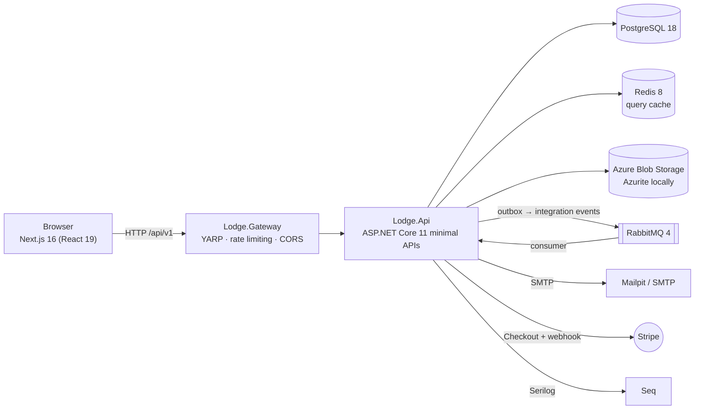
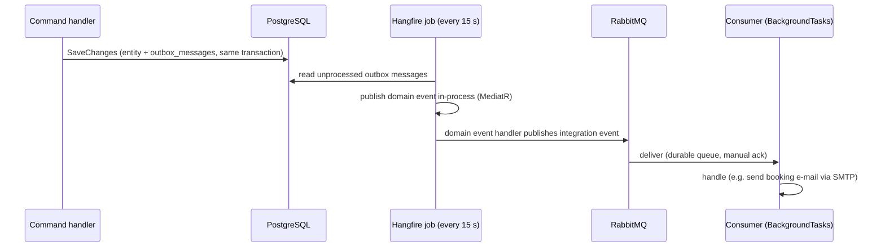
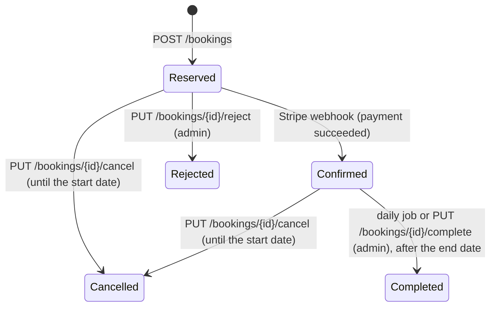

# Architecture

Lodge is split into a **Next.js frontend** and an **ASP.NET Core backend** that follows Clean Architecture with CQRS. All browser traffic goes through a YARP gateway.

## Backend layers

| Project | Responsibility | May reference |
| --- | --- | --- |
| `Lodge.Domain` | Entities, value objects (`Email`, `Money`, `DateRange`, …), domain events, domain services (`PricingService`), repository interfaces, `Result`/`Error` primitives. No framework dependencies. | — |
| `Lodge.Contracts` | Request/response DTOs and e-mail models shared over the wire. | — |
| `Lodge.Application` | Use cases as MediatR commands/queries + handlers, FluentValidation validators, pipeline behaviors, abstractions for infrastructure (`ICacheService`, `IEmailService`, …). | Domain, Contracts |
| `Lodge.Infrastructure` | JWT, password hashing, Redis cache, MailKit e-mail, RabbitMQ publisher, blob storage, Hangfire, health checks, time provider. | Application |
| `Lodge.Persistence` | EF Core `LodgeDbContext` (snake_case naming), configurations, migrations, repositories, Dapper connection factory, interceptors (auditing, soft delete, outbox), idempotency store. | Application |
| `Lodge.BackgroundTasks` | RabbitMQ consumer hosted service and integration-event handlers (mostly e-mail notifications). | Infrastructure |
| `Lodge.Presentation` | Minimal API endpoints (`IEndpoint`), result → HTTP mapping, problem details, OpenAPI configuration. | Application |
| `Lodge.Api` | Composition root: `Program.cs`, middleware pipeline, migrations + demo seeding in Development. | everything |
| `Lodge.Gateway` | YARP reverse proxy in front of the API, with per-IP fixed-window rate limiting and CORS. | — |

The layering rules are enforced by `Lodge.ArchitectureTests` (NetArchTest).

## Request pipeline

Every command or query goes through these MediatR behaviors, in this order:

1. **RequestLogging** logs the request name and, on failure, the error. It uses Serilog with a correlation id from `RequestContextLoggingMiddleware`.
2. **Validation** runs the FluentValidation validators and short-circuits with a `ValidationError` result.
3. **QueryCaching** caches the results of `ICachedQuery` queries in Redis. User-specific queries are never cached.
4. **UnitOfWork** calls `SaveChangesAsync` only when the command succeeded.
5. **IdempotentCommand** replays the stored result when a client repeats a request with the same idempotency key. Keys are only consumed on success.

Handlers return `Result`/`Result<T>` instead of throwing. `Lodge.Presentation` maps error types to HTTP status codes:

| Error type | HTTP status |
| --- | --- |
| Validation | 400 |
| Problem | 400 |
| NotFound | 404 |
| Conflict | 409 |
| Permission | 403 |
| Failure (unexpected) | 500 |

Missing or invalid JWTs are rejected with 401 by the authentication middleware.

Errors are returned as `application/problem+json`.

## Events and the outbox

* An interceptor collects domain events and writes them to `outbox_messages` in the same transaction as the aggregate, so no event is lost.
* Hangfire processes the outbox on a schedule set by `BackgroundJobs:Outbox:Schedule`.
* The consumer deserializes only an allow-list of known integration event types. It retries a failed message once and then rejects it.

## Booking lifecycle

`BookingStatus` values on the wire are `1 = Reserved`, `2 = Confirmed`, `3 = Rejected`, `4 = Cancelled` and `5 = Completed`.

Guests can reserve, pay for and cancel their own bookings. Rejecting and completing bookings is reserved for the `Admin` role. A Hangfire recurring job (`complete-finished-bookings`, daily at 03:00 UTC by default) completes confirmed stays once they've ended, through the same domain method, so the completion e-mail is still sent via the outbox.

The price is calculated by `PricingService`: nightly price × nights, plus an amenity up-charge (a percentage per amenity), plus the cleaning fee.

## Security

* **Authentication:** stateless JWTs (HMAC-SHA256), validated for issuer, audience, lifetime and signature. Each token carries a `role` claim (`Guest` or `Admin`), and admin-only endpoints use an `Admin` authorization policy.
* **Authorization:** handlers check that the `userId` in the request matches the token, so users can only read or change their own bookings, reviews, profile and files.
* **Passwords:** hashed with PBKDF2-HMAC-SHA512 (210,000 iterations, 16-byte random salt). The stored string is `pbkdf2-sha512$<iterations>$<salt>$<hash>`, so the iteration count can be raised later without breaking existing hashes. Hashes are compared in constant time.
* **Stripe webhooks** are verified with the `Stripe-Signature` header before anything is processed.
* **Rate limiting:** the gateway allows 600 requests per minute per IP by default.

## Frontend

The frontend is a Next.js 16 App Router app in `frontend/`. See [frontend.md](frontend.md) for its structure and conventions.
