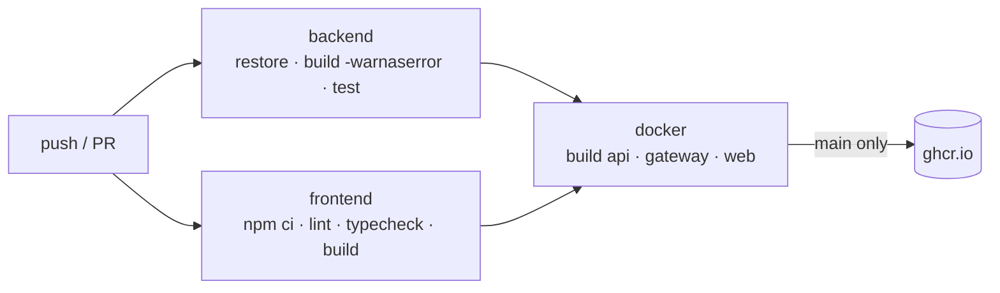

# CI/CD

A single workflow, [`.github/workflows/ci.yml`](../.github/workflows/ci.yml), runs on every pull request, on every push to `main`, and on manual dispatch.



| Job | What it does |
| --- | --- |
| **backend** | Sets up the SDK from `global.json`. Builds `Lodge.slnx` in Release with warnings treated as errors, then runs all test projects. The integration and functional tests start PostgreSQL and Redis with [Testcontainers](https://dotnet.testcontainers.org/), using the Docker engine that GitHub-hosted runners provide. TRX results and coverage are uploaded as the `test-results` artifact. |
| **frontend** | Runs `npm ci`, ESLint, `tsc --noEmit` and `next build` in `frontend/`. |
| **docker** | Builds the three images once both jobs above pass. On pull requests the images are only built, to check that the Dockerfiles still work. On `main` they are pushed to GitHub Container Registry. |

## Published images

Pushes to `main` publish these images:

| Image | Dockerfile |
| --- | --- |
| `ghcr.io/<owner>/lodge-api` | `backend/src/Lodge.Api/Dockerfile` |
| `ghcr.io/<owner>/lodge-gateway` | `backend/src/Lodge.Gateway/Dockerfile` |
| `ghcr.io/<owner>/lodge-web` | `frontend/Dockerfile` |

Each image is tagged `latest` and `sha-<short-sha>`. Publishing uses the built-in `GITHUB_TOKEN`, so no secrets need to be configured.

> [!NOTE]
> The `lodge-web` image bakes `NEXT_PUBLIC_API_BASE_URL` in at build time, because Next.js inlines public env vars. To point it at a different API, rebuild the image with `--build-arg NEXT_PUBLIC_API_BASE_URL=https://api.example.com`.

The workflow stops at publishing images. Deploying them to a hosting platform depends on your infrastructure. A typical next step is a job that runs after `docker`, e.g. `az containerapp update --image ...` or a `kubectl set image ...`.

## Dependabot

[`.github/dependabot.yml`](../.github/dependabot.yml) opens grouped weekly PRs for NuGet and npm, and monthly PRs for GitHub Actions and Docker base images.

## Running the same checks locally

```bash
# backend
dotnet build Lodge.slnx -c Release -warnaserror
dotnet test Lodge.slnx -c Release          # needs Docker for the integration tests

# frontend
cd frontend
npm ci && npm run lint && npm run typecheck && npm run build
```
